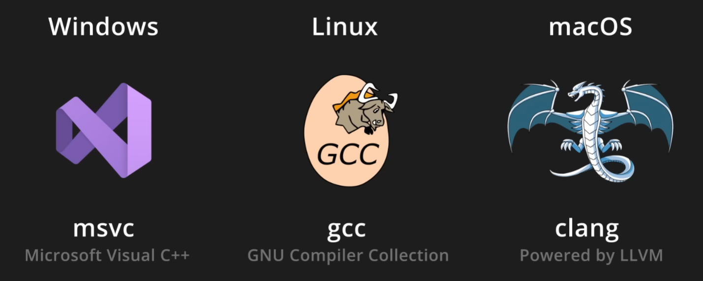
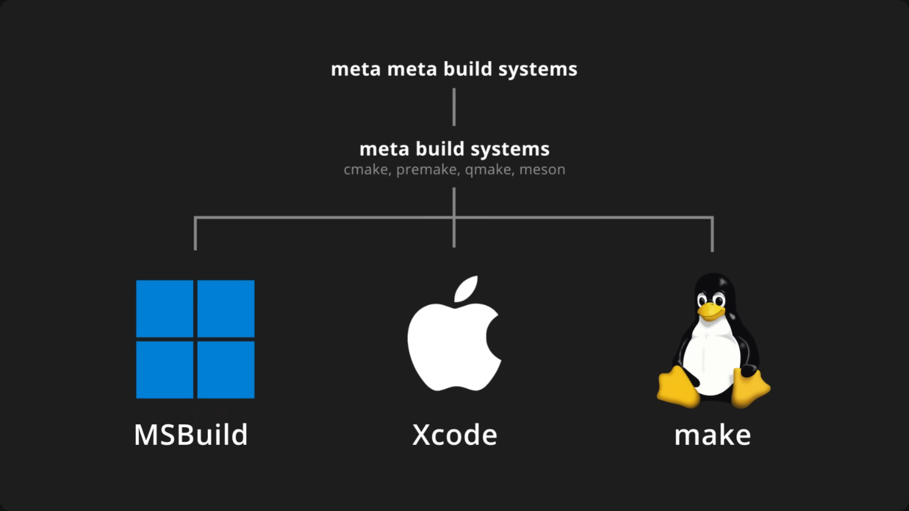
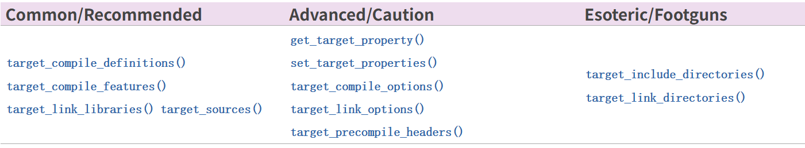
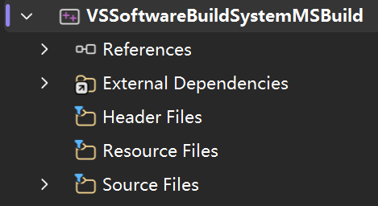
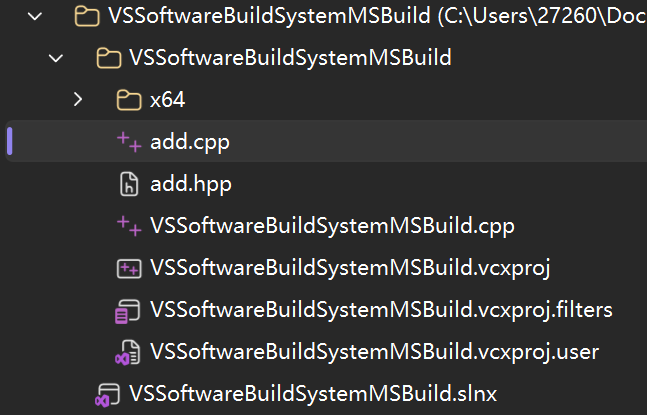
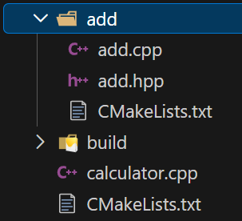
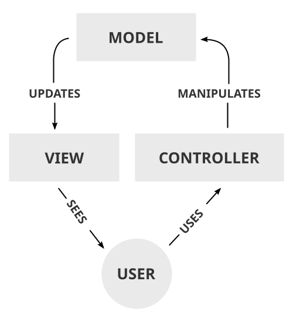

> 主要来自于：[youtube](https://www.youtube.com/watch?v=7fGB-hjc2Gc)、[cmake tutorial](https://cmake.org/cmake/help/latest/guide/tutorial/index.html)、[MSLearn](https://learn.microsoft.com/cpp/)、[MSBlog](https://devblogs.microsoft.com/cppblog)

## 一、导入

> 正式打开 CMake 的大门之前，可以先去品鉴一下 25 年末诞生的 C++ 圣经：[The worst programming language of all time](https://www.youtube.com/watch?v=7fGB-hjc2Gc) 虽然标题起的很犀利，但是能喷 2h 也不是一般人

当我们构建项目时，必不可免地会遇到导入第三方库函数的情况，对于最原始的 C 语言，我们或许可以通过宏(Macros) + 头文件的形式来简单处理文件之间的依赖关系。

但是当项目层次上升到构建整个应用的时候，简简单单地头文件引用略显乏力了。

Build System 也就由此而生。

## 二、可执行文件是怎么造出来的？

> 一定不要忘记打开显示拓展名和显示隐藏和系统文件（下图展示 Windows 11）
>
> 



先了解一下编译器，正如上图所示，对于不同的操作系统，我们有不同的常用编译器。而之所以存在不同的编译器，除了标配的操作系统（实际上，编译器并无操作系统之分，只不过是常用而已），最主要的问题是在早期 C\+\+ 研发中，诞生出了各种各样的编译环境（包括运行时库与 ABI），他们不过是跟随着不同的编译环境做出了相应的优化。


```Plain Text
gcc -o hello hello.c
```

如图所示，对于最简单的单文件程序（hello.c），编译器经过了：预处理（处理宏`.i`）、编译（分析文件内容，生成汇编文件`.s`）、汇编（依据不同系统，产生对应的机器码文件`.o`）、链接（将相关的机器码文件链接到一起，生成最终的`.exe`可执行文件）的历程（图中最后的 hello 是 linux / macos 环境下的可执行文件）

但是对于超过数百乃至上千文件的情况下，我们需要在 gcc 后面一个一个，全部手动敲打到命令最后，这对于构建大型项目来说，很难实现对于单个功能的实际测试，也很难实现对于整个软件系统的整体把握。

## 三、乱七八糟、啰里啰嗦

基于这个现状 Build System 诞生了，早期的 Build System 以 make 为例，可以简单视作在一个文件（Makefile）中提前写好构建整个项目的脚本，最后直接执行脚本，这运行你在正式编译之前做一些预处理，或者更加便捷的声明作用域。

```Makefile
build:
    gcc -o hello hello.c
run:
    ./hello
```

```Plain Text
// 生成 hello.exe
make build

// 执行 hello.exe
make run
```



然而，正如上图展示的那样，基于不同的操作系统，C++ 世界中存在不同的 Build System ，对于跨平台应用，C++ 世界中存在多种 Meta Build System，对于跨平台应用的不同 Meta Build System 我们还有进一步的 Meta Meta Build System，尝试进一步控制这些 Meta Build System（比如 [vcpkg](https://learn.microsoft.com/vcpkg/) 那样的包管理器，通过处理依赖那些依赖来处理构建中的依赖问题）

而作为最被广泛应用的 Meta Build System，cmake 成为了实际上的行业标杆。

## 四、一种语言

就像 C++ 一样，cmake 作为一种 Meta Build System 同时还是一种语言，官方称之为 CMakeLang。

> 对于 CMakeLang 而言，一切都是 string

类似于 bash / pwsh 命令，他允许你在正式生成 build system 文件之前提前设定一些变量，执行一些逻辑，下面展示一些常用关键字：

```CMake
# 定义变量 source_files 为源文件列表
set(source_files hello.c world.c)

# 输出 Hello 源文件列表
message("Hello ${source_files}")

# 执行列表命令 APPEND，向 source_files 中添加新的源文件
list(APPEND source_files another.c)

# 依次输出列表中的每个文件
foreach(file IN LISTS source_files)
    message(${file})
endforeach()

# 判断语句
if(True)
    message("True")
else()
    message("False")
endif()

# 定义宏 MyMacro
macro(MyMacro MacroArg)
    message("MacroArg: ${MacroArg}")
endmacro()

# 定义函数 MyFunction
function(MyFunction FunctionArg)
    MyMacro("FunctionArg: ${FunctionArg}")
endfunction()

# 执行函数 MyFunction
MyFunction("hello~")

# 包含其他 CMake 文件
include(other.cmake)
```

运行一下：`cmake -P main.cmake`

## 五、基本组成

> 下一步就来搞一个简单的加法计算器

通常来说，一个基本的 CMake 项目会存在至少一个位于项目根位置上的 CMakeLists.txt (下面简写为 CML ) 文件，供 cmake 工具读取，生成 build system 代码。而对于一个存在于项目根位置上的 CML 来说，至少包含以下两个命令。

```CMake
# 指定 cmake 版本应该位于 3.0 到 4.0 范围内
cmake_minimum_required(VERSION 3.0...4.0)

# 指定项目名称
project(MathProject)
```

但是仅仅只有这两条还是不够的，他们仅仅只是声明了项目本身的内容，确保 cmake 的正常执行。而对于大多数 C++ 项目来说，我们要么想要得到一个或者多个可执行文件，要么想要得到一个可以供其他人调用的库。由此， cmake 提供了以下两种命令：`target_sources()`、`add_executable()`、`add_library()`来控制目标内容（其中对于较为简单的项目可以直接去除`target_sources()`，将其中的内容直接填写在`add_executable()`或`add_library()`的命名后）

```CMake
# 限定 cmake 的最小版本
cmake_minimum_required(VERSION 4.0)

# 命名项目
project(MathProject)

# 添加创建可执行文件选项
add_executable(Calculator)

# 添加目标文件
target_sources(Calculator
    PRIVATE
        ${CMAKE_CURRENT_SOURCE_DIR}/calculator.cpp
)

# 添加子文件夹
add_subdirectory(add)

# 链接其他库
target_link_libraries(Calculator PRIVATE add)
```

```CMake
# 添加目标库选项
add_library(add INTERFACE)

# 添加目标文件
target_sources(add
    INTERFACE
        ${CMAKE_CURRENT_SOURCE_DIR}/add.cpp
        ${CMAKE_CURRENT_SOURCE_DIR}/add.hpp
)
```



除了上述命令以外，我们还有很多高级命令/根据框架额外添加的命令来适配复杂多变的项目架构。

## 六、build

正如上文提到的 cmake 是一种meta build system，他负责生成 build system，同时接管 build system 的下一步构建

```Bash
# 在当前文件夹的 build 目录下创建 build system 相关文件
cmake -B ./build

# 在 build 文件夹中编译出可执行文件
cmake --build build
```

在第一步中，会产生诸如：`CMakeCache.txt`、`cmake_install.cmake`、`build.ninja`、`Makefile`等等文件，这取决于你选择的编译器/所在的编译环境等等，而对于第二步，必须在存在`CMakeCache.txt`的文件夹中运行。

除了`-B`/`--build`选项外，cmake 还提供了很多可选选项通过`-D`来传达，用于进一步掌控 cmake 在第一步是的选项。

```CMake
# 创建选项
option(BUILD_FOR_WINDOWS_ONLY "Control whether or not this program is built for windows" OFF)

# 根据结果执行对应内容
if(BUILD_FOR_WINDOWS_ONLY)
    ……
else()
    ……
endif()
```

```Bash
# 只为 Windows 构建
cmake -B ./build -DBUILD_FOR_WINDOWS_ONLY=ON
```

## 七、CMakePresets.json

除了 build 以外，cmake 还能够执行一系列工作流，而`CMakePreset.json`就是负责简化这些工作流的方案，包括：`configurePresets`、`buildPresets`、`testPresets`、`packagePresets`、`workflowPresets`

```JSON
{
    "version": 8,
    "configurePresets": [
        {
            "name": "MathProject",
            "displayName": "GCC 15.2.0 x86_64-w64-ucrt64",
            "description": "Using compilers: C = gcc, CXX = g++",
            "generator": "MinGW Makefiles",
            "binaryDir": "${sourceDir}/out/build/${presetName}",
            "cacheVariables": {
                "CMAKE_INSTALL_PREFIX": "${sourceDir}/out/install/${presetName}",
                "CMAKE_C_COMPILER": "path/to/gcc",
                "CMAKE_CXX_COMPILER": "path/to/g++",
                "CMAKE_BUILD_TYPE": "Debug"
            }
        }
    ],
    "buildPresets": [
    {
      "name": "MathProject",
      "configurePreset": "MathProject",
      "displayName": "Build MathProject"
    }
  ]
}
```

## 八、how about IDE？

> ~~JetBrain 不是已经营收赤字了吗~~

对于不同的 IDE 他们有不同的 CMake 食用指南：[VS](https://learn.microsoft.com/cpp/build/cmake-projects-in-visual-studio)、[CLion](https://www.jetbrains.com/help/clion/cmake0.html)、[VS Code](https://learn.microsoft.com/vcpkg/get_started/get-started-vscode)。

## 九、文件结构与架构

相信绝大多数同学新建出的一个 C++ 项目大概率都是使用 VS 的默认模版，在模版中使用的是标准的 [MSBuild](https://learn.microsoft.com/visualstudio/msbuild/msbuild)，这里，他简单的依照头文件/源文件的形式来划分文件内容，而实际上打开了文件视图，你会发现，这里只是看起来好看一些，实际上所有文件堆在一个根文件夹中，对于较小型的项目，这或许很方便，但是一旦步入了大型项目，后期的维护就变得困难了起来，如左中图

而对于 cmake 项目来说，我们更推荐依照功能划分文件，如右图。







同时对于不同的项目类型，我们还有不同的项目架构：用于网络应用开发的 MVC（左图）、用于桌面应用开发的 MVVM（右图）等等。




## 十、拓展内容

除了 cmake 以外，我们还有 xmake、qmake、meson 等等 meta build systems，但是正如最开始的图中给出的，除了 meta build systems 我们还有 meta meta build system（这里指包管理器），其中主要包括以下三种：

[vcpkg](https://learn.microsoft.com/en-us/vcpkg/)、[hunter](https://hunter.readthedocs.io/)、[conan](https://conan.io/)

这里是一个使用类似于 python 那样的可读性较好的语言来处理构建系统的元构建系统，同时还具有跨语言能力：

[bazel](https://bazel.build/)

但是，~~鉴于 C++ 委员会一直不管不顾，~~不论是 build system、meta build system、meta meta build system 都没有一个确切的官方正式稳定版本，因此，对于普通开发者而言，如何掌控好自己的项目，如何一步一步构建出一个真正的便于维护的项目，就算是在现在的 AI 时代也永远是难以绕开的问题，以及成为 C++ 开发者的必由之路~~（氵氵氵）~~

