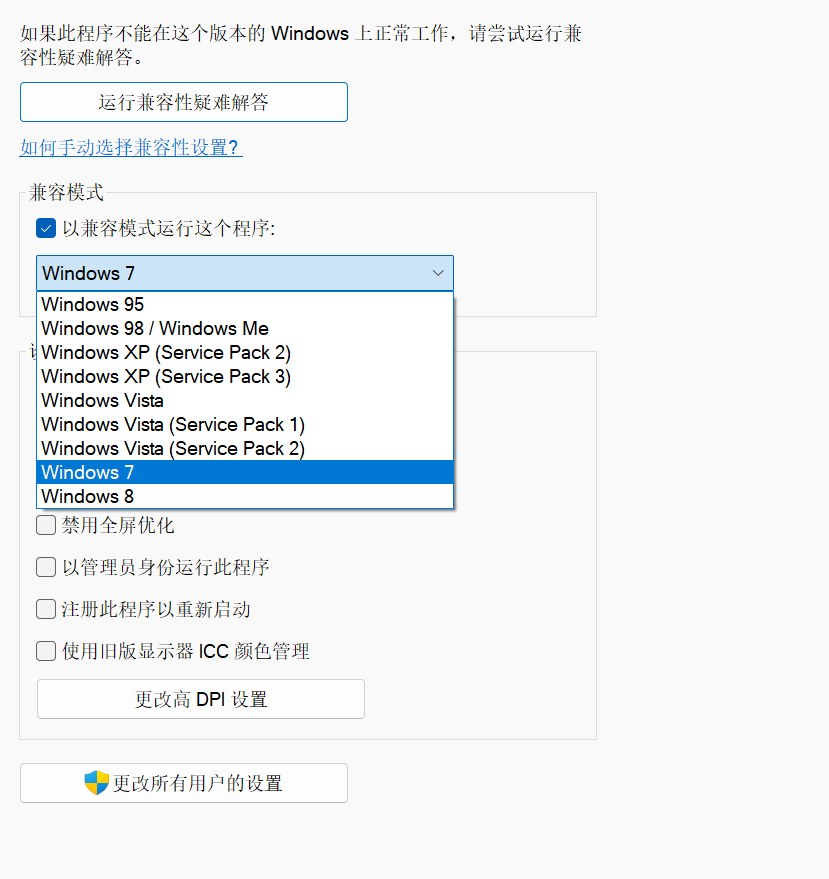
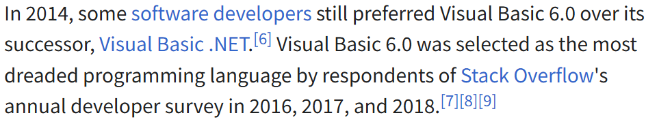
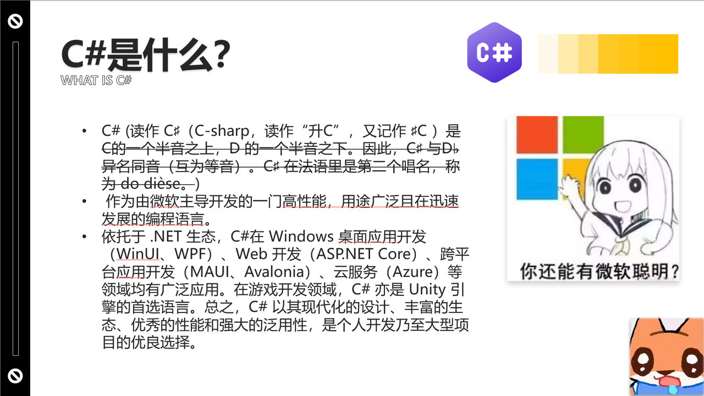

> 来自 [programminglanguages](https://www.programminglanguages.co/)、[MS DevBlogs](https://devblogs.microsoft.com/)、[MS Learn](https://learn.microsoft.com/)、[StackOverflow](https://stackoverflow.com/)、[wikipedia](https://en.wikipedia.org/)、[dotnet runtime github](https://github.com/dotnet/runtime)、[Godot Docs](https://docs.godotengine.org/)、[youtube](https://www.youtube.com/)、[bilibili](https://www.bilibili.com/)、[nuget](https://www.nuget.org/)

## 一、导入


> 于是便有了这次 ignite 的主题（


众所周知，随着各种[逆向 skll](https://github.com/morluto/rea) 的诞生以及各种大手子发力，MC 进入了强兼(容)时代，而 Windows 作为大多数游戏玩家难以绕过的鸿沟，作为一个兼容性极强的操作系统，他为老应用单独提供了从 Win95 到 Win8 的兼容模式（这里用的是 Win11 专业版）



除了 Windows 本身，MS 在进行 .NET 研发过程中同样也考虑去兼容那个诸神混战时代下诞生的各种编程语言 ~~（虽然现在看来好像不如把所有软件都重构成 Rust）~~


## 二、Introduction to .NET（Also [.NYET](https://www.youtube.com/watch?v=TH5118PhzYs)）

> 注意到，一旦提及 .NET 必然引出 C# ~~（就像提到 C# 必然引出 Unity）~~

.NET 作为一个开源免费跨平台的开发者平台（free, cross-platform, open-source developer platform），而一套完整的 .NET 实现通常包括以下几点：Runtime、Class library、Application frameworks (Optionally)、development tools (Optionally)

除了我们现在常说的 .NET（准确来说应该是 .NET Core），微软在官方文档里面同时还给出了以下两种实现：.NET Framework、[Mono](https://www.mono-project.com/)。前者作为微软早期闭源期间的一套专注于 Windows 平台的实现，后者则是与之相对的开源跨平台实现。

而在 .NET Core 诞生的时候，Mono 就已经确定被 .NET Core 吸纳，除此以外，Mono 也活跃于诸如 Unity 这样游戏引擎内部（[部分游戏引擎](https://docs.godotengine.org/en/4.4/contributing/development/compiling/compiling_with_dotnet.html)为了兼容现代的 C# 也选择提供了 .NET Core 的兼容拓展）

```txt

[ C# 源代码 ]
      │
      ▼  (使用 Roslyn 编译器, 如 csc)
[ CIL / IL ]  <-- 平台无关的字节码（保存在 .dll 或 .exe 中）
      │
      ▼  (在目标机器上由 CLR JIT 编译器处理)
[ 机器码 ]    <-- 针对具体 CPU 架构的本地指令（如 x86, x64, ARM）

```

除了官方/社区打包好的这些实现以外，微软还给出了 [Common Language Runtime (CLR)](https://en.wikipedia.org/wiki/Common_Language_Runtime) 、[Common Intermediate Language (CIL)](https://en.wikipedia.org/wiki/Common_Intermediate_Language) 以及集大成的 [Common Language Infrastructure (CLI)](https://en.wikipedia.org/wiki/Common_Language_Infrastructure) 这套思路，这允许开发者自行选择甚至构建自己偏爱的编译器与开发者工具，进而使用各种各样歪七扭八的可以归 Runtime 托管的语言来完成 .NET 项目。

下面这个链接用通俗易懂的语言描述了C++、C#、Java 在性能与开发体验上的权衡利弊：

[C++ Performance vs. Java vs. C#](https://stackoverflow.com/questions/145110/c-performance-vs-java-c)

## 三、 .NET 组件（Components）

1. Runtime 也就是Run and Debug ，负责处理执行引擎、垃圾回收等一系列与运行时相关的内容
2. Libraries 负责提供编译时的核心代码（类似于 C 语言开头所用的头文件）
3. Compiler 即编译器（ [Roslyn](https://github.com/dotnet/roslyn) 是官方维护的 C# 和 VB 的专属编译器）
4. SDK and other tools 也就是辅助软件开发的一系列工具包（比如 [NuGet](https://learn.microsoft.com/en-us/nuget/what-is-nuget)）
5. App stacks 例如 [ASP.NET](https://njupt-sast.feishu.cn/wiki/Z8kmwa4KkirKBckaV40cvZpxnGb)[ Core](https://njupt-sast.feishu.cn/wiki/Z8kmwa4KkirKBckaV40cvZpxnGb) 、[WinUI 3](https://njupt-sast.feishu.cn/wiki/Zy59wXUnjinmTWkTA49cIyTqnrb) 等即有模版

## 四、 .NET 生态（Ecosystem）

> (.NET Core) It's evolving and actively supported.
> (.NET Framework) It's actively supported, in maintenance. —— Microsoft

1. .NET (Core) 也就是现代 .NET。具有跨平台的特性以及[开源的仓库](https://github.com/dotnet)
2. .NET Framework 原始 .NET。仅仅服务于 Windows
3. Mono 由Xamarin公司主持的社区，目的是打造一系列符合 ECMA 标准的 .NET 工具，现在依旧活跃于一些游戏引擎内部。

## 五、初见端倪

正如上文提到的，设计者在设计 .NET 生态的时候，不仅仅满足于将 MS 自己开发的编程语言应用于 .NET 应用程序开发（也就是上文中提到的几个 C\_\_\_\_ ），由此为语言的设计者提供了一套[开发范式](https://github.com/dotnet/runtime/blob/main/docs/design/coreclr/botr/intro-to-clr.md#fundamental-features-of-the-clr)。

而其他语言通过实现这套范式来融入到 .NET 生态中的典型案例，便是 Visual 与 Iron 家族。

### 1、Visual

> ~~a visual programming language, block coding system or diagrammatic programming language：~~[~~Scratch~~](<https://en.wikipedia.org/wiki/Scratch_(programming_language)>)

[Visual Basic(class)](<https://en.wikipedia.org/wiki/Visual_Basic_(classic)>)：[Visual Basic (.NET)](<https://en.wikipedia.org/wiki/Visual_Basic_(.NET)>)、 [Visual Basic for Applications (VBA)](https://en.wikipedia.org/wiki/Visual_Basic_for_Applications)、[VBScript](https://en.wikipedia.org/wiki/VBScript)



[Visual J++](https://en.wikipedia.org/wiki/Visual_J%2B%2B)：[Java](<https://en.wikipedia.org/wiki/Java_(programming_language)>)、[Comparison_of_C_Sharp_and_Java](https://en.wikipedia.org/wiki/Comparison_of_C_Sharp_and_Java)

[Visual C++(MSVC)](https://en.wikipedia.org/wiki/Microsoft_Visual_C%2B%2B)：[vcpkg](https://learn.microsoft.com/en-us/vcpkg)、[C++/CLI](https://learn.microsoft.com/cpp/dotnet/dotnet-programming-with-cpp-cli-visual-cpp)

[Visual FoxPro](https://en.wikipedia.org/wiki/Visual_FoxPro)、[Visual Object](https://en.wikipedia.org/wiki/Visual_Objects)

Visual Studio、Visual Studio Code

### 2、Iron

Iron 作为 MS 基于上述 CLR 基础上，进一步推广至 [Dynamic Language Runtime (DLR)](https://en.wikipedia.org/wiki/Dynamic_Language_Runtime) 而催化出的家族，其尝试着将类似于 Python、Ruby 这样的动态类型语言嵌入到 .NET 程序中。

[IronScheme](https://en.wikipedia.org/wiki/IronScheme)、[IronPython](https://en.wikipedia.org/wiki/IronPython)、[IronRuby](https://en.wikipedia.org/wiki/IronRuby)

## 六、是 ♯ 不是 #，是 # 不是 ♯



至于后来为啥又出现了 # 家族呢？主要是面对 .NET 开源之后的勃勃生机万物竞发的情况下，MS 同时也需要为各个领域抉择出自己官方认同的方向，作为后期维护的主要方向。

[Visual J#](https://en.wikipedia.org/wiki/J_Sharp)、[C#](https://learn.microsoft.com/en-us/dotnet/csharp/)、[Polyphonic C#](https://nickbenton.name/polyphony.html)、[Cω](https://www.microsoft.com/en-us/research/project/comega/)、[Spec#](https://www.microsoft.com/en-us/research/project/spec/)、[Q#](https://learn.microsoft.com/en-us/azure/quantum/qsharp-overview)、[R#](https://rsharp.net/)、[F#](https://learn.microsoft.com/en-us/dotnet/fsharp/)

[G#](https://davidobando.github.io/gsharp/)、[L#](https://github.com/jmj0502/LSharp)、[X#](https://www.xsharp.eu/)、[A#](<https://en.wikipedia.org/wiki/A_Sharp_(.NET)>)、[S#](https://en.wikipedia.org/wiki/Script.NET)、[M#](https://www.msharp.co.uk/#/Overview/README)

## 七、所以说 .NET 到底能干什么？

**Anything！**

正如上方 PPT 截图中展示的那样，.NET 多多少少也是一个从诸神混战的时代中爬出来的一个开发框架，而正所谓没有最好的语言，只有没人用的语言，对开发框架来说也是这个道理 ~~（虽然 .NET 在国内大厂几乎没哪个大厂用）~~ ，依托于庞大的生态和开发过程中极低的心智负担，.NET 就是能够协助开发者迅速、便捷的开发出一款能跑的 APP 的框架。

## 八、[dotnet tools](https://learn.microsoft.com/dotnet/core/additional-tools/)

除了最基础的 SDK 以外，Dotnet 还提供了一些其他开发工具

|         name         |                                                      usage                                                      |
| :------------------: | :-------------------------------------------------------------------------------------------------------------: |
|      dotnet cli      | 专为 dotnet 日常开发提供的 cli，其中包括了通过模版新建项目（默认不会新建文件夹！）、添加 nuget 包、安装其他工具 |
|        nuget         |                                           dotnet 世界的官方的包管理器                                           |
| \.NET Uninstall tool |                                             卸载本地的 dotnet 环境                                              |
|       dotnetup       |                            类似于 rustup 通过交互式来配置本地 dotnet 环境（preview）                            |

# 九、[Microsoft.Extensions](https://learn.microsoft.com/en-us/dotnet/api/?view=net-11.0&term=Microsoft.Extensions)

自从[开源](https://github.com/dotnet/dotnet/tree/main/src/runtime/src/libraries)以来，MS 将自己的开发中的工具包暴露给外界：

|                                                             name                                                              |                    usage                     |
| :---------------------------------------------------------------------------------------------------------------------------: | :------------------------------------------: |
|             [Microsoft\.Extensions\.Hosting](https://learn.microsoft.com/dotnet/api/microsoft.extensions.hosting)             | 提供一组用于管理整个应用程序资源生命周期的类 |
|             [Microsoft\.Extensions\.Logging](https://learn.microsoft.com/dotnet/api/microsoft.extensions.logging)             |             提供处理日志相关事务             |
|       [Microsoft\.Extensions\.Configuration](https://learn.microsoft.com/dotnet/api/microsoft.extensions.configuration)       |             提供应用配置项的管理             |
| [Microsoft\.Extensions\.DependencyInjection](https://learn.microsoft.com/dotnet/api/microsoft.extensions.dependencyinjection) |             提供依赖注入相关内容             |
|             [Microsoft\.Extensions\.Options](https://learn.microsoft.com/dotnet/api/microsoft.extensions.options)             |           提供了基于选项模式的实现           |

至于定义与 nuget 包请分别搜索自：[.NET API browser](https://learn.microsoft.com/dotnet/api/)、[nuget](https://www.nuget.org/)

右侧是一些应用举例：[Console App](https://learn.microsoft.com/dotnet/core/extensions/dependency-injection/usage)、[ASP\.NET](https://learn.microsoft.com/aspnet/core/fundamentals/dependency-injection)

## 十、[CommunityToolkits](https://learn.microsoft.com/dotnet/communitytoolkit/)

除了官方提供的拓展包以外，Dotnet 社区依据实际开发中的情况与需求，也同时实现了一些用于便携开发的拓展包。类似于 [C++ 的 Boost 委员会](https://www.boost.org/) (?)，很多内容后期也被官方吸纳。

|                                                             name                                                              |                                              usage                                               |
| :---------------------------------------------------------------------------------------------------------------------------: | :----------------------------------------------------------------------------------------------: |
|                   [CommunityToolkit\.Mvvm](https://learn.microsoft.com/en-us/dotnet/communitytoolkit/mvvm/)                   |                                 提供了基于 MVVM 架构的一系列抽象                                 |
|     [CommunityToolkit\.Diagnostics](https://learn.microsoft.com/en-us/windows/communitytoolkit/diagnostics/introduction)      | 提供了一组性能更高的边界检查与异常处理 API <br/>（现在主要用于已经大规模使用过，难以切换的项目） |
| [CommunityToolkit\.HighPerformance](https://learn.microsoft.com/en-us/windows/communitytoolkit/high-performance/introduction) |                                  提供了一些高性能的通用类型拓展                                  |

至于定义与 nuget 包请分别搜索自：[.NET API browser](https://learn.microsoft.com/dotnet/api/)、[nuget](https://www.nuget.org/)

右侧是一些应用举例：[WinUI3](https://learn.microsoft.com/windows/apps/get-started/)
