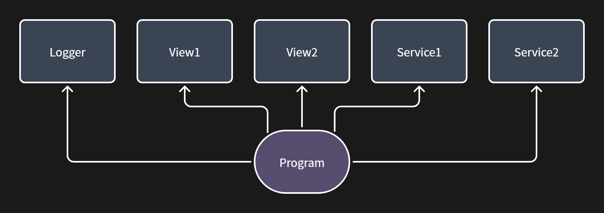
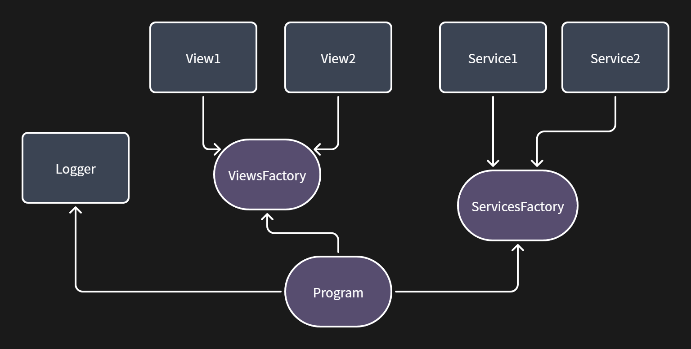
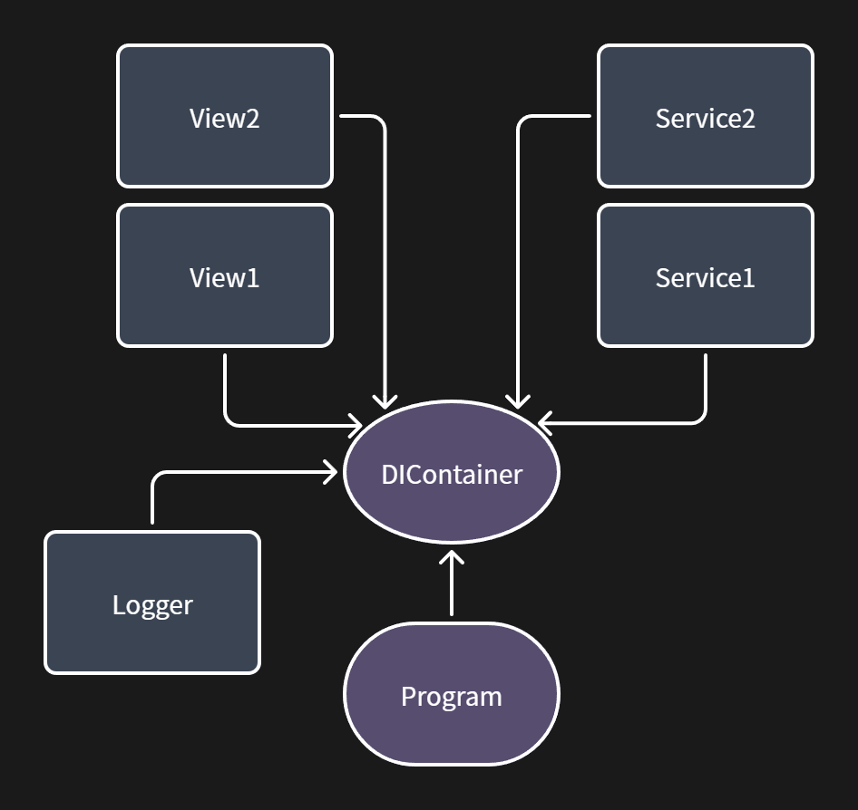

## 一、导入

在考虑依赖这个概念之前，我们先来回顾一下面向对象的三大特性：封装性、继承性、多态性。

## 二、封装

之所以从封装起步，主要是因为面向对象本质上就是通过一层一层的封装来实现的。（Has-A）

在 C 语言时期，旨在封锁私密的内容，暴露允许访问的内容，我们初步的尝试使用各种结构体（struct）来来包装好一组相关的或者应当融为一体的数据，但是考虑到结构体本身并没有强制的控制访问权限，这对于当时的企业级开发来说无疑是致命的问题，于是乎就有了我们所谓的访问控制关键字。

而之后的继承性是设计 OOP 时所考虑的一套规范，多态性则好像是前者引起的副作用。（Is-A）

## 三、依赖

而当我们真正按照功能来封装好了以后，另一个问题就出现了：怎么把他们整合起来？

对于简单的程序，我们可以考虑封装这一组类，将所有其他的类都在此创建出实例，然后通过不同类之间通过第三方方法来联合起来，共同完成某些任务。

但是在这里，就出现了我们所谓的依赖，即程序类依赖于其他所有类。

但是显然，想要维护这样一个`Super Program`需要消耗大量的精力，因为我们很难完全掌握一个类里面到底有哪些方法（尤其是对于团队协作而言），而且根据 SOLID 原则中的依赖反转原则来看，上图的做法反而将所有依赖关系交给`Program`来处理也是不合适且难以维护的。

最简单的做法就是加一个中间层：`Services`、`Views`，由他们来控制视图是否被呈现，服务是否被调用、如何被调用，同时将`Program`反过来交给他们调用，这样也就实现了所谓的依赖反转。

## 四、依赖注入容器

> 参考：[MSLearn](https://learn.microsoft.com/dotnet/core/extensions/dependency-injection/overview)

就像上图展示的那样，对于`View1`和`View2`或者对于`Service1`和`Service2`来说，`Views`和`Services`各自作为一个工厂类，负责掌控他们的创建。那么，我们是不是也可以创建一个并行的第三方类来掌控他们整个生命周期呢？

如图，`Program`不依赖任何类，相反，他被背后的`DIContainer`依赖，`Program`的启动会通知`DIContainer`创建一个全新的`ServiceProvider`，由他来负责掌控其他服务的生命周期与依赖关系。

## 五、生命周期

研究过 Unity 引擎的生命周期的都知道，对于一个普通的 GameObject，我们有以下几个生命周期函数函数：

|  阶段  |     函数      |
| :----: | :-----------: |
| 初始化 |    Awake()    |
|        |  OnEnable()   |
|        |    Start()    |
|  更新  | FixedUpdate() |
|        |   Update()    |
|        | LateUpdate()  |
|  停用  |  OnDisable()  |
|  销毁  |  OnDestroy()  |

|  阶段  |    函数     |
| :----: | :---------: |
| 初始化 |   Awake()   |
|        |   Start()   |
|  更新  |  Update()   |
|  停用  | OnDisable() |
|  销毁  | OnDestroy() |

或者像这边，简化一下。

总的来说，可以划分为三个步骤：创建->更新->销毁

而对于 IoC 容器而言，它仅仅负责创建与销毁，至于更新则交给 IoC 容器创建的实例自己控制

对于 [Microsoft.Extensions.DependencyInjection](https://learn.microsoft.com/dotnet/api/microsoft.extensions.dependencyinjection) 来说，他提供了三个常用的作用域（Scope），并以此来调控实例的构建与删除

| Singleton |  单例  |                         与整个 IoC 容器同作用域（即 Root Scope 根作用域），通常来说会存在于整个应用                          |
| :-------: | :----: | :--------------------------------------------------------------------------------------------------------------------------: |
|  Scoped   | 作用域 |  通常用于网络中那些天然携带作用域的情况，也可以通过 IServiceScopeFactory 临时创建一个作用域配合 using 语句进行进一步的掌控   |
| Transient | 瞬时的 | 通常在无状态服务中使用，会在每次需要使用时创建新的服务 （并不意味着会随着任务完成而销毁，他的生命周期通常交由 GC 控制） |

谈到`using`关键字，就不得不提`IDisposable`接口。简单来说，他定义了在实例被销毁时会执行内容，对于大多数关系到文件流的类，他们大都会实现这个接口，来专门控制对于所操作的文件的状态~~避免出现文件正在被占用的问题~~
